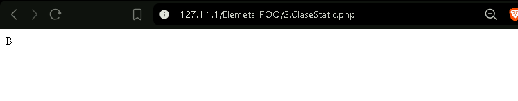
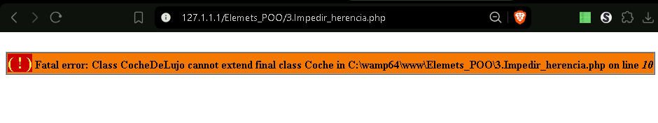
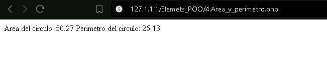
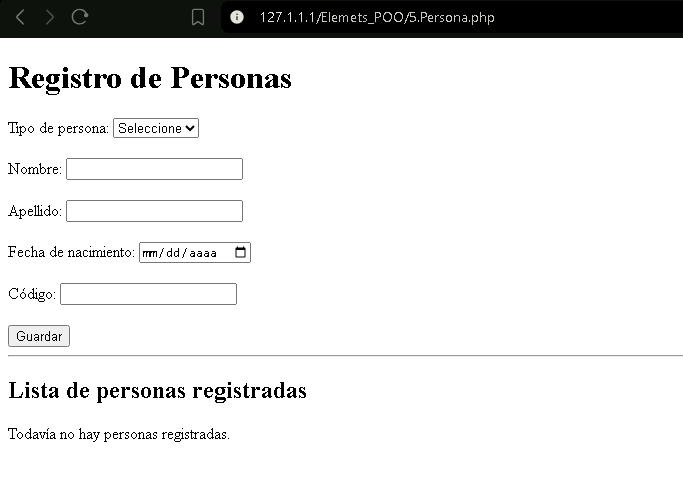
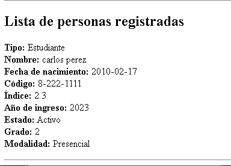
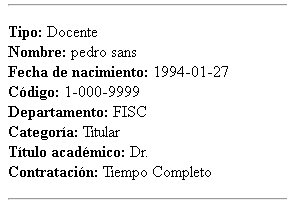

# Prácticas de POO en PHP — Desarrollo Web


Este repositorio contiene la resolución de los 5 problemas prácticos de **Programación Orientada a Objetos (POO)** desarrollados para el curso de Desarrollo Web en PHP.

---

## 🛠️ Tecnologías y Requisitos

| Tecnología | Insignia | Descripción |
| :--- | :---: | :--- |
| **Lenguaje** |  | PHP 8.x con soporte POO |
| **Servidor** |  | Servidor HTTP Web |
| **Entorno** |  | Entorno local de desarrollo |
| **Control de Versiones** |  | Control de versiones distribuido |

---

## 📁 Estructura del Proyecto

```text
poo-practicas/
├── img/
│   ├── Ejemplo_1.png           # Captura de ejecución del Problema #1
│   ├── Ejemplo_2.png           # Captura de ejecución del Problema #2
│   ├── Ejemplo_3.png           # Captura de ejecución del Problema #3
│   ├── Ejemplo_4.png           # Captura de ejecución del Problema #4
│   ├── Ejemplo_5_registro.png  # Captura del modelo Persona
│   ├── Ejemplo_5_estudiante.png# Captura de la clase Estudiante
│   └── Ejemplo_5_docente.png   # Captura de la clase Docente
├── problema1.php               # Herencia básica (Coche y CocheDeLujo)
├── problema2.php               # Enlace estático en tiempo de ejecución (Late Static Binding)
├── problema3.php               # Clases y métodos finales (final class)
├── problema4.php               # Constantes de clase y cálculo geométrico (Círculo)
├── problema5.php               # Jerarquía de clases (Persona, Estudiante, Docente)
└── README.md                   # Documentación principal
```

---

## 📌 Índice de Problemas

| Problema | Concepto POO Evaluado | Estado | Captura Directa |
| :---: | :--- | :---: | :---: |
| **Problema #1** | Encapsulamiento y Herencia (`Coche` / `CocheDeLujo`) |  | [📸 Ver Captura](#captura-p1) |
| **Problema #2** | Vinculación Estática Tardía (`static::` vs `self::`) |  | [📸 Ver Captura](#captura-p2) |
| **Problema #3** | Restricción de Herencia (`final class`) |  | [📸 Ver Captura](#captura-p3) |
| **Problema #4** | Métodos y Constantes de Clase (`Circulo`) |  | [📸 Ver Captura](#captura-p4) |
| **Problema #5** | Modelado e Jerarquía (`Persona`, `Estudiante`, `Docente`) |  | [📸 Ver Captura](#captura-p5) |

---

## 📌 Descripción de los Problemas y Soluciones

### Problema #1: Herencia Básica (`Coche` y `CocheDeLujo`)

**Concepto:** Reutilización de código a través de la herencia (`extends`) y el acceso a miembros protegidos (`protected`).

```php
<?php
class Coche {
    protected string $color;

    public function setColor(string $color): void {
        $this->color = $color;
    }

    public function getColor(): string {
        return $this->color;
    }

    public function printCaracteristicas(): void {
        echo "Color: " . $this->getColor() . "<br>";
    }
}

class CocheDeLujo extends Coche {
    protected string $extras;

    public function setExtras(string $extras): void {
        $this->extras = $extras;
    }

    public function getExtras(): string {
        return $this->extras;
    }

    // Sobrescritura del método padre
    public function printCaracteristicas(): void {
        echo "Color: " . $this->color . "<br>";
        echo "<hr>";
        echo "Extras: " . $this->extras . "<br>";
    }
}

// Ejecución
$miCoche = new CocheDeLujo();
$miCoche->setColor('negro');
$miCoche->setExtras('TV');
$miCoche->printCaracteristicas();
?>
```

<a id="captura-p1"></a>
#### 📸 Evidencia de Ejecución (Problema #1)

*Instanciación y uso de métodos heredados de CocheDeLujo.*

---

### Problema #2: Late Static Binding (`static::` vs `self::`)

**Concepto:** Demostración del enlace estático en tiempo de ejecución. Al usar `static::miFuncion()`, PHP invoca la función según el contexto de la clase que hace la llamada original (Clase `B`), a diferencia de `self::` que mantendría el enlace rígido con la clase donde fue definido el método (Clase `A`).

```php
<?php
class A {
    public static function miFuncion(): void {
        echo __CLASS__;
    }

    public static function otraFuncion(): void {
        // Late Static Binding resuelve a la clase que realiza la llamada
        static::miFuncion(); 
        // Si se cambia "static" por "self" este mostrara "A"
    }
}

class B extends A {
    public static function miFuncion(): void {
        echo __CLASS__;
    }
}

// Ejecución
B::otraFuncion(); // Imprime: B
?>
```

<a id="captura-p2"></a>
#### 📸 Evidencia de Ejecución (Problema #2)

*Resolución dinámica de clases con static::.*

---

### Problema #3: Restricción de Herencia (`final class`)

**Concepto:** Prevenir que una clase sea heredada utilizando la palabra reservada `final`. Al intentar extender una clase declarada como `final`, el intérprete de PHP genera un error fatal (`Fatal error: Class CocheDeLujo may not inherit from final class Coche`).

```php
<?php
final class Coche {
    public function getColor(): void {
        echo "Rojo";
    }
}

// Este bloque provocará un error fatal deliberado
class CocheDeLujo extends Coche {
    // Error: No se puede heredar de una clase final
}
?>
```

<a id="captura-p3"></a>
#### 📸 Evidencia de Ejecución (Problema #3)

*Manejo del error fatal por herencia rechazada.*

---

### Problema #4: Cálculo Geométrico y Constantes (`Circulo`)

**Concepto:** Uso de propiedades privadas, constantes nativas/personalizadas (`M_PI` o `self::PI`), y formateo numérico con `number_format()`.

```php
<?php
class Circulo {
    private float $radio;

    public function __construct(float $radio) {
        $this->radio = $radio;
    }

    public function calcularArea(): float {
        return M_PI * ($this->radio * $this->radio);
    }

    public function calcularPerimetro(): float {
        return 2 * M_PI * $this->radio;
    }
}

// Ejecución
$miCirculo = new Circulo(4);

echo "<br>";
echo "Área del círculo:\t" . number_format($miCirculo->calcularArea(), 2, ".", "") . "<br>";
echo "Perímetro del círculo:\t" . number_format($miCirculo->calcularPerimetro(), 2, ".", "") . "<br>";
?>
```

<a id="captura-p4"></a>
#### 📸 Evidencia de Ejecución (Problema #4)

*Cálculo formateado de área y perímetro.*

---

### Problema #5: Jerarquía Completa (`Persona`, `Estudiante` y `Docente`)

**Concepto:** Implementación de modelos de dominio completos extendiendo una clase base común (`Persona`) para representar entidades específicas de un entorno universitario (`Estudiante` y `Docente`).

```php
<?php
// Persona.php
class Persona {
    protected string $nombre;
    protected string $apellido;
    protected string $fechaNacimiento;

    public function __construct(string $nombre, string $apellido, string $fechaNacimiento) {
        $this->nombre = $nombre;
        $this->apellido = $apellido;
        $this->fechaNacimiento = $fechaNacimiento;
    }

    public function getNombre(): string { return $this->nombre; }
    public function getApellido(): string { return $this->apellido; }
    public function getFechaNacimiento(): string { return $this->fechaNacimiento; }
}

// Estudiante.php
class Estudiante extends Persona {
    protected float $indiceAcademico;
    protected int $cohorte;
    protected int $estadoAcademico; // 1 = Activo, 0 = Inactivo, 2 = Retirado
    protected int $modalidadEstudio; // 1 = Presencial, 2 = Virtual, 3 = Híbrida

    public function __construct(
        float $indiceAcademico, 
        int $cohorte, 
        int $estadoAcademico, 
        int $modalidadEstudio, 
        string $nombre, 
        string $apellido, 
        string $fechaNacimiento
    ) {
        parent::__construct($nombre, $apellido, $fechaNacimiento);
        $this->indiceAcademico = $indiceAcademico;
        $this->cohorte = $cohorte;
        $this->estadoAcademico = $estadoAcademico;
        $this->modalidadEstudio = $modalidadEstudio;
    }

    public function getIndiceAcademico(): float { return $this->indiceAcademico; }
    public function getCohorte(): int { return $this->cohorte; }
    public function getEstadoAcademico(): int { return $this->estadoAcademico; }
    public function getModalidadEstudio(): int { return $this->modalidadEstudio; }
}

// Docente.php
class Docente extends Persona {
    protected string $codigoDocente;
    protected string $departamento;
    protected string $categoriaRango; // Titular, Adjunto, Especial
    protected string $maximoTitulo;
    protected string $tipoContratacion; // Tiempo Completo, Tiempo Parcial

    public function __construct(
        string $codigoDocente,
        string $departamento,
        string $categoriaRango,
        string $maximoTitulo,
        string $tipoContratacion,
        string $nombre,
        string $apellido,
        string $fechaNacimiento
    ) {
        parent::__construct($nombre, $apellido, $fechaNacimiento);
        $this->codigoDocente = $codigoDocente;
        $this->departamento = $departamento;
        $this->categoriaRango = $categoriaRango;
        $this->maximoTitulo = $maximoTitulo;
        $this->tipoContratacion = $tipoContratacion;
    }

    public function getCodigoDocente(): string { return $this->codigoDocente; }
    public function getDepartamento(): string { return $this->departamento; }
    public function getCategoriaRango(): string { return $this->categoriaRango; }
    public function getMaximoTitulo(): string { return $this->maximoTitulo; }
    public function getTipoContratacion(): string { return $this->tipoContratacion; }
}

// Ejemplo de Instanciación
$miEstudiante = new Estudiante(3.5, 2023, 1, 2, "Juan", "Pérez", "2000-05-15");

echo "El nombre del estudiante es: " . $miEstudiante->getNombre() . "<br>";
echo "El apellido del estudiante es: " . $miEstudiante->getApellido() . "<br>";
echo "La fecha de nacimiento del estudiante es: " . $miEstudiante->getFechaNacimiento() . "<br>";
echo "El índice académico del estudiante es: " . $miEstudiante->getIndiceAcademico() . "<br>";
echo "El cohorte del estudiante es: " . $miEstudiante->getCohorte() . "<br>";
echo "El estado académico del estudiante es: " . $miEstudiante->getEstadoAcademico() . "<br>";
echo "La modalidad de estudio del estudiante es: " . $miEstudiante->getModalidadEstudio() . "<br>";
?>
```

<a id="captura-p5"></a>
#### 📸 Evidencias de Ejecución (Problema #5)
  
  
  
*Salida en pantalla con atributos de la clase base y de las clases hijas.*

---

## 👨‍💻 Autor

- **Nombre:** Eloy Samaniego
- **Carrera:** Licenciatura en Ciberseguridad — Universidad Tecnológica de Panamá
- **Módulo:** Desarrollo Web — Práctica de POO